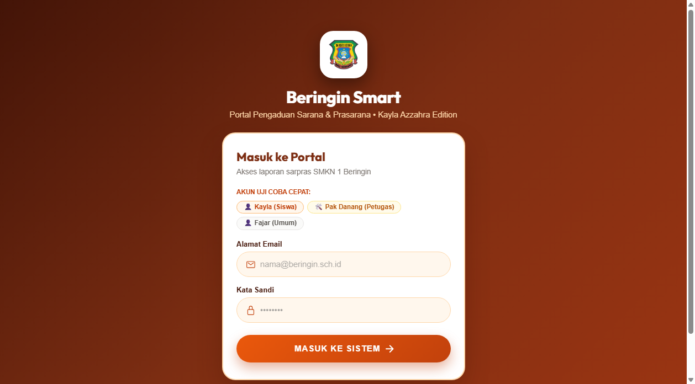
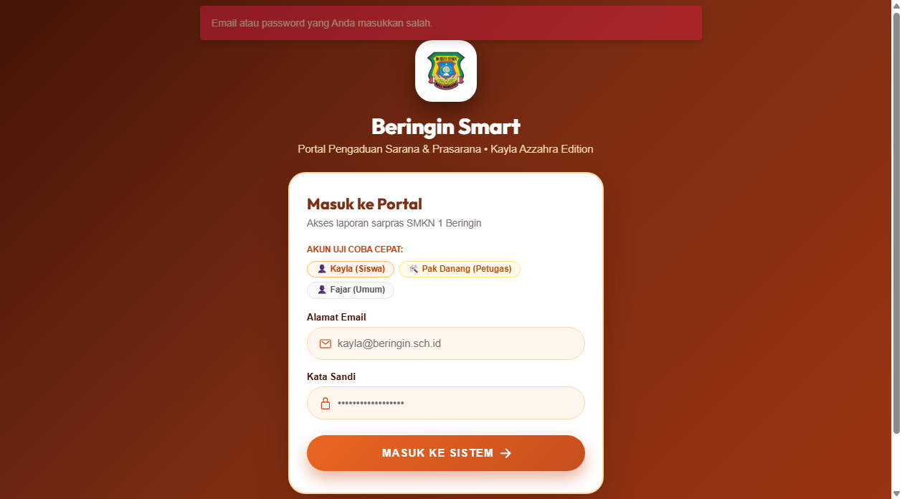
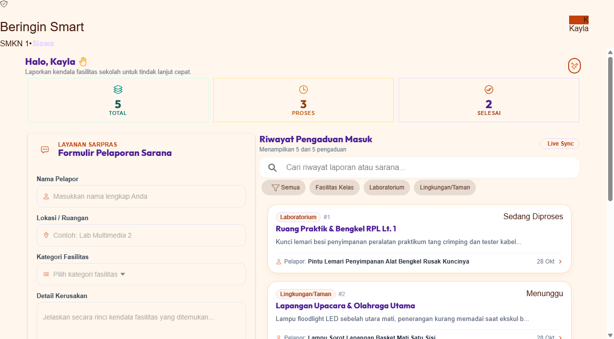
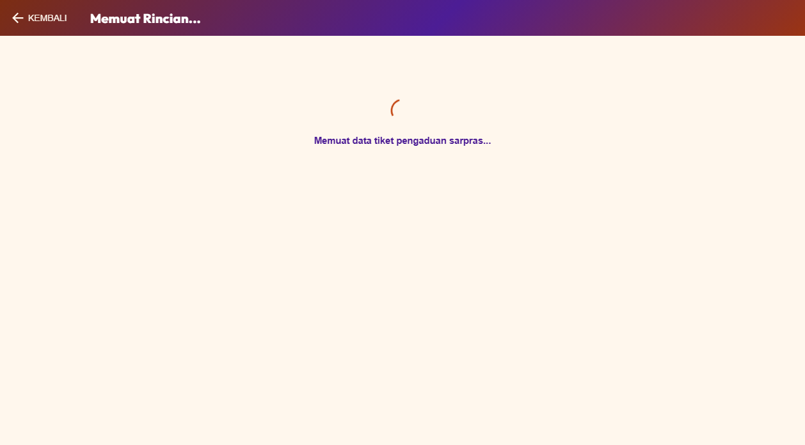
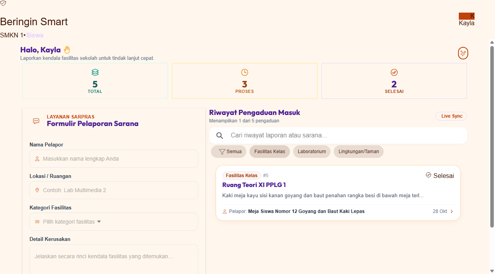
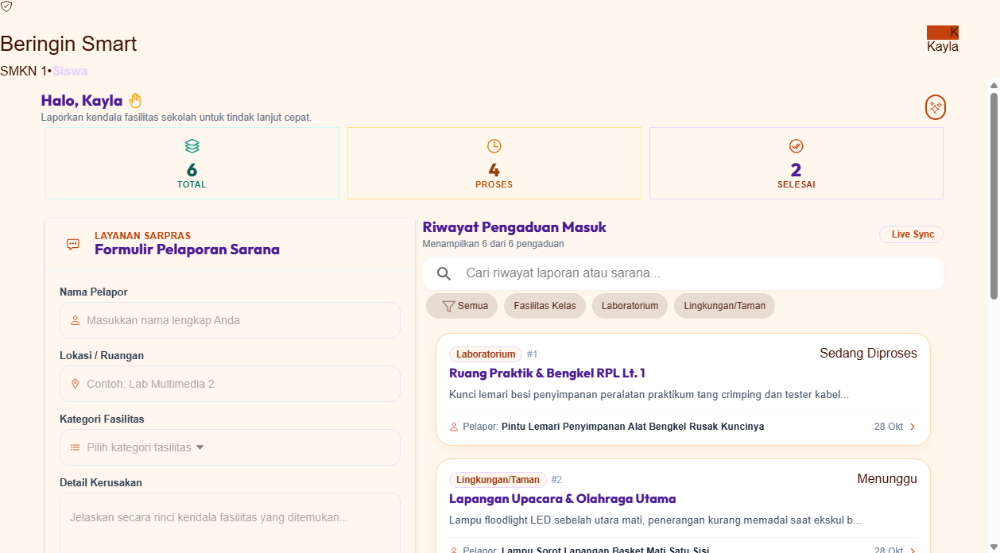
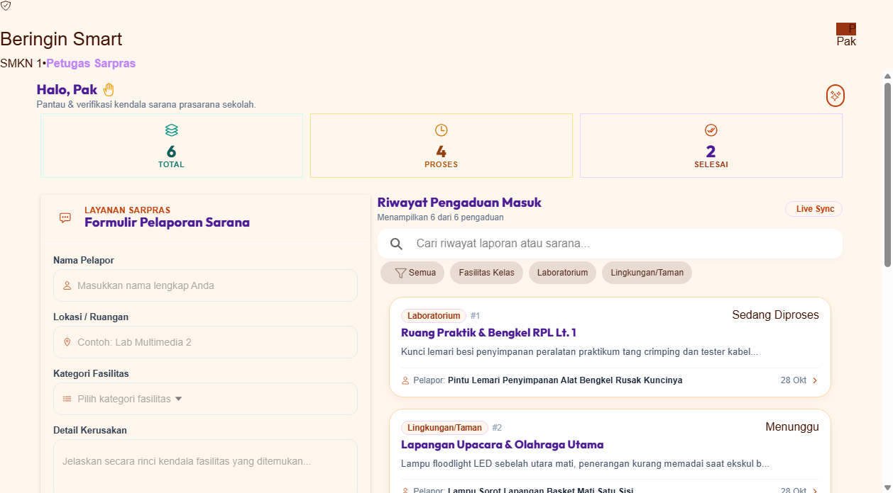
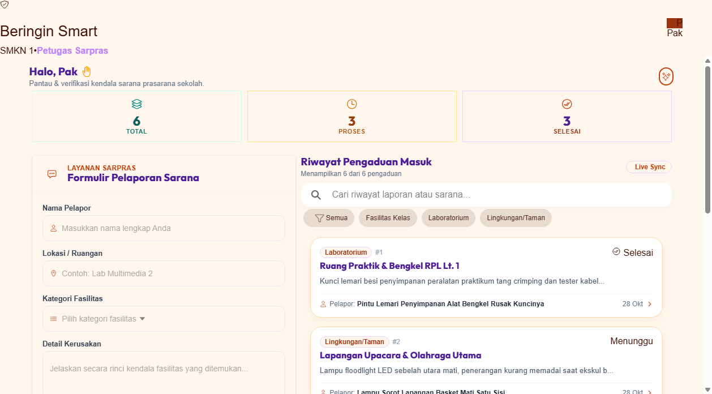
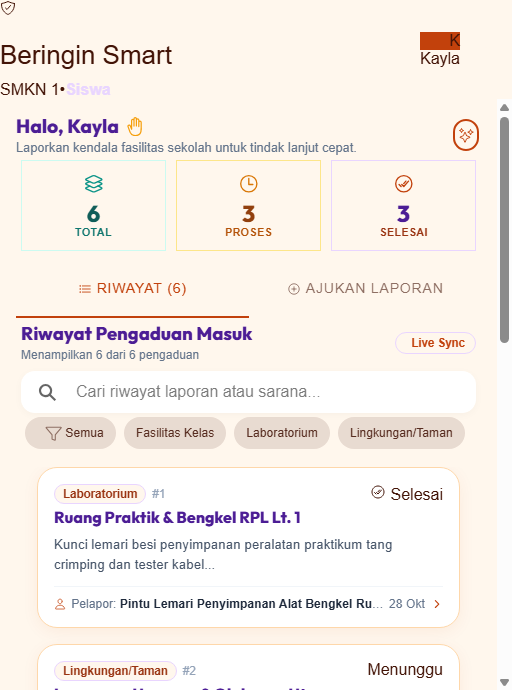

# Beringin Smart 🏫 • Kayla Azzahra Edition

<div align="center">
  
  <h2>Sistem Informasi & Manajemen Pengaduan Sarana Prasarana Sekolah</h2>
  <p><strong>SMK Negeri 1 Beringin Deli Serdang</strong></p>
  <p><em>Tema Desain: Sunset Terracotta & Warm Sand (Contemporary Warm Pill Styling)</em></p>
</div>

---

## 📌 Identitas Proyek & Pengembang

| Atribut | Informasi Terdaftar |
| :--- | :--- |
| **Nama Siswa** | **Kayla Azzahra** |
| **Kelas & Jurusan** | **XI Pengembangan Perangkat Lunak & Gim 1 (XI PPLG 1)** |
| **Sekolah** | SMK Negeri 1 Beringin, Deli Serdang |
| **Petugas / Teknisi** | Pak Danang *(Teknisi Sarana & Prasarana)* |
| **Database Aktif** | MySQL: `beringin_smart_kayla` |
| **Teknologi Backend** | Laravel 11 Framework, REST API, Sanctum Authentication |
| **Teknologi Frontend** | Ionic 8 React, Vite, TypeScript, Terracotta Warm Design System |

---

## 🎨 Karakteristik & Filosofi Desain

Edisi Kayla Azzahra mengusung konsep **Sunset Terracotta & Warm Sand**:
- **Palet Warna**: Terracotta hangat (`#c2410c`, `#7c2d12`), aksen tangerine keemasan, dan latar belakang lembut (`#fff7ed`).
- **Kartu & Komponen**: Menggunakan gaya kontemporer pill-shaped inputs (`border-radius: 9999px`) dan tombol oval melayang.
- **Halaman Login**: Menampilkan perisai logo sekolah dengan kontras hangat, tombol preset kredensial berbentuk pil, dan form bertekstur premium.
- **Header Beranda**: Gradient sunset yang megah dengan identitas sekolah dan avatar pelapor.

---

## 📸 Dokumentasi Tangkapan Layar Aplikasi

Berikut adalah hasil pengujian langsung sistem Beringin Smart edisi Kayla Azzahra:

| No | Modul / Halaman | Tangkapan Layar |
| :---: | :--- | :--- |
| **01** | **Portal Login Siswa & Petugas**<br>Halaman autentikasi hangat dengan logo sekolah SMKN 1 Beringin |  |
| **02** | **Notifikasi Kredensial Salah**<br>Sistem proteksi dan pesan peringatan saat login tidak valid |  |
| **03** | **Daftar Pengaduan Sarpras Aktif**<br>Feed laporan kerusakan fasilitas dengan kartu beraksen terracotta |  |
| **04** | **Tinjauan Rinci Kerusakan Sarana**<br>Detail informasi lengkap tiket sarana sekolah |  |
| **05** | **Filter Tipe Fasilitas Sekolah**<br>Penyortiran cepat kategori sarana kelas, lab, atau lingkungan |  |
| **06** | **Form Registrasi Pengaduan**<br>Formulir pelaporan kerusakan dengan input pill rounded khas edisi Kayla |  |
| **07** | **Tiket Baru Berhasil Terbit**<br>Verifikasi tiket yang baru dilaporkan langsung terdaftar di sistem |  |
| **08** | **Panel Manajemen Petugas**<br>Dashboard kontrol bagi Pak Danang untuk memantau perbaikan |  |
| **09** | **Eksekusi Penanganan Sarana**<br>Halaman detail penugasan perbaikan sarana oleh petugas |  |
| **10** | **Verifikasi Laporan Selesai**<br>Pemberitahuan bahwa kerusakan fasilitas telah selesai diperbaiki |  |
| **11** | **Responsivitas Layar Mobile**<br>Tampilan antarmuka responsif di layar ponsel |  |

---

## 🚀 Panduan Menjalankan Aplikasi di Lokal

### 1. Prasyarat Sistem
- **Laragon / XAMPP**: Pastikan MySQL berjalan pada port `3306`.
- **PHP**: Versi 8.2 atau lebih baru.
- **Node.js**: Versi 18 atau 20 LTS.

### 2. Konfigurasi Database
1. Buka Laragon / MySQL Client, buat database:
   ```sql
   CREATE DATABASE beringin_smart_kayla;
   ```
2. Pastikan file `.env` pada folder `beringin-backend` memuat:
   ```env
   DB_CONNECTION=mysql
   DB_HOST=127.0.0.1
   DB_PORT=3306
   DB_DATABASE=beringin_smart_kayla
   DB_USERNAME=root
   DB_PASSWORD=
   ```

### 3. Menjalankan Server Backend
```bash
cd beringin-backend
php artisan serve
```
Backend berjalan di: `http://127.0.0.1:8000`

### 4. Menjalankan Aplikasi Frontend
```bash
cd Beringin-Smart
npm run dev
```
Frontend berjalan di: `http://127.0.0.1:5173`

### 5. Akun Pengujian
- **Akun Siswa**: `kayla@beringin.sch.id` | Kata Sandi: `password123`
- **Akun Petugas**: `petugas@beringin.sch.id` | Kata Sandi: `password123`
- **Akun Siswa Umum**: `siswa@beringin.sch.id` | Kata Sandi: `password123`